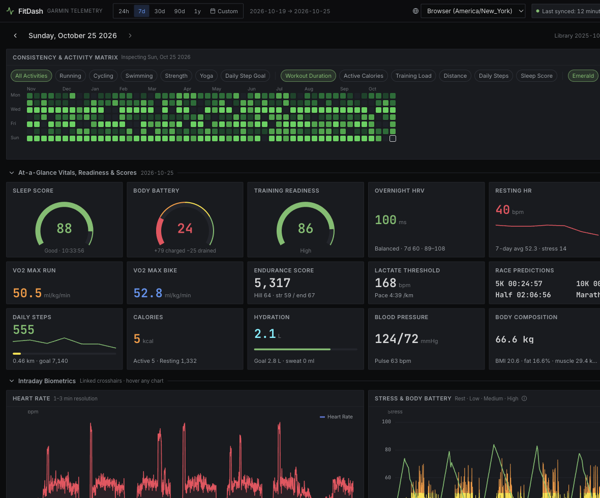

# FitDash

Local-first Garmin Connect dashboard. Syncs health and workout telemetry into SQLite (WAL), then visualizes it as a Grafana-dark, high-density React dashboard — including a GitHub-style 52-week activity heatmap and a monthly habit matrix.

Tokens stay in `./.garmin_tokens`. The database lives in `./data/fitdash.db`. Nothing is sent anywhere except Garmin Connect.



## Stack

- **Backend:** Python 3.11+ / FastAPI, `garminconnect` + `garth`, `fitparse`, SQLite
- **Frontend:** React 18 + TypeScript + Vite + Tailwind + ECharts + Leaflet

## Run

```bash
# API (from repo root)
cd backend
python3 -m venv .venv && source .venv/bin/activate
pip install -e ".[dev]"
python run.py

# UI (second terminal)
cd frontend
npm install
npm run dev
```

Open http://localhost:5173. On first launch, sign in to Garmin (MFA supported). Choose a lookback window (default 90 days, up to 3 years). Later launches — and **Sync Now** — only fetch from the watermark through today.

### Offline demo (no Garmin account)

```bash
cd backend && source .venv/bin/activate
python run.py --demo            # seed 365 days if the DB is empty
python run.py --demo --reset    # wipe and regenerate
```

Then start the Vite UI as above.

Production-style single process: `cd frontend && npm run build`, then `python run.py` serves `frontend/dist` from `:8000`.

## Sync model

| Mode | When | Window |
| --- | --- | --- |
| Initial | `sync_metadata` is empty | Configurable lookback (default 90d) |
| Delta | Subsequent launches / Sync Now | `last_synced_date − 1 day` → today |
| Manual | Custom range in the API | Caller-specified |

Writes are idempotent upserts. Activity `.fit` files download only for new `activity_id`s. Progress streams over SSE at `/api/sync/events`.

## Environment

All settings use the `FITDASH_` prefix (see `backend/app/config.py`), e.g. `FITDASH_LOOKBACK_DAYS=365`.

## Initial prompt

The app was built from this brief:

```text
# Role & Objective
Act as a Principal Full-Stack Systems Engineer and Data Visualization Architect. Here is the prompt. Use it as a guideline so feel free to modify the plan. It is just a recommendation.

Build a local-first, self-hosted web application that fetches, stores, and visualizes Garmin Connect health and workout telemetry.

The visual design and metric coverage must replicate the dark-mode, high-density telemetry aesthetic of the `arpanghosh8453/garmin-grafana` project, enhanced with an interactive GitHub-style Activity Contribution Heatmap and Habit Completion Matrix.

---

# 1. Recommended Tech Stack
- **Backend:** Python 3.11+ with **FastAPI**
  - Garmin Integration: `garminconnect` (with `garth` for persistent OAuth1/OAuth2 session tokens) and `fitparse` for parsing raw `.fit` activity files.
  - Real-time Sync Progress: Server-Sent Events (SSE) or WebSockets to stream sync progress to the UI.
- **Database:** **SQLite** (with WAL mode enabled) or **DuckDB** for fast local time-series queries without requiring external Docker containers like InfluxDB.
- **Frontend:** **React 18+ (TypeScript, Vite)** + **Tailwind CSS** + **Lucide Icons**
  - Charts & Heatmaps: **Apache ECharts** (supports synchronized crosshairs across panels, 2D heatmaps, and radial gauges)
  - GPS Maps: **MapLibre GL** or **Leaflet** (with dynamic metric-colored polylines)

---

# 2. Core Feature 1: Stateful Incremental Sync Engine (Initial vs. Delta Sync)
 syncing data is the entry point of the application lifecycle.

1. **Authentication & Session Persistence:**
   - On first launch, if no valid `garth` token exists in `./.garmin_tokens`, prompt the user for Garmin Connect credentials (supporting MFA tokens if triggered) and persist the session tokens locally.
2. **Sync State Tracking (`sync_metadata` Table):**
   - Maintain a table tracking `metric_domain`, `last_synced_date` (YYYY-MM-DD), `last_synced_timestamp` (UTC ISO-8601), and `status`.
3. **First Sync (Initial Historical Backfill):**
   - When `sync_metadata` is empty, automatically trigger an Initial Sync for a configurable lookback window (default: last 90 days, user-adjustable to 1+ years).
   - Stream granular progress to the frontend (e.g., `"Syncing 2026-08-14: Heart Rate, Sleep, Activities [42/90 days]..."`).
4. **Subsequent Syncs (Delta / Watermark Sync):**
   - On every subsequent app launch (or when clicking **"Sync Latest"**), query `last_synced_date` from `sync_metadata`.
   - Fetch **only** data from `last_synced_date` through `today`.
   - **Idempotent Upserts:** Re-fetch `last_synced_date` and `today` using `INSERT OR REPLACE` / `ON CONFLICT DO UPDATE` so partial intraday metrics (Steps, Heart Rate, Body Battery, Stress) and late-uploaded workouts update cleanly without creating duplicate rows.
   - For activities, store `activity_id` as a primary key and only download/parse `.fit` files for `activity_id`s not yet present in the local database.

---

# 3. Core Feature 2: GitHub-Style Activity Heatmap & Habit Completion Matrix
Place a dedicated, interactive **Consistency & Activity Matrix** panel near the top of the dashboard with two toggleable views:

1. **View A: 52-Week GitHub Contribution Grid**
   - A 7-row (Mon–Sun) by 52-column (Weeks) heatmap grid.
   - **Filter Pills:** Filter grid by `All Activities`, `Running`, `Cycling`, `Swimming`, `Strength`, `Yoga`, or `Daily Step Goal`.
   - **Color Intensity Selector:** Dynamically scale the 5-level color gradient (Grafana dark-emerald or neon cyan palette) based on user selection:
     - *Workout Duration (minutes)*
     - *Active Calories Burned*
     - *Training Load / Activity Distance*
     - *Daily Step Count / Sleep Score*
   - **Interactivity:** Hovering over any day cell shows a rich tooltip (Date, Activity Names, Total Duration in `HH:MM:SS`, Distance, Avg HR, Calories). Clicking a day cell sets the dashboard's active inspection date to that day.
2. **View B: Monthly Habit & Sport Matrix**
   - A 31-day matrix where rows represent distinct movement/recovery categories (`Run`, `Ride`, `Swim`, `Strength`, `Mobility/Yoga`, `Steps >= Goal`, `Sleep Score >= 80`) and columns represent days of the selected month.
   - Include current streak, best streak, and 7-day / 30-day completion rate percentages on the right margin.

---

# 4. Core Feature 3: `garmin-grafana` Visual UI & Full Metric Parity
Style the interface after a Grafana Dark Dashboard:
- **Theme:** Deep carbon background (`#0b0c0e`), panel surfaces (`#181b1f`), subtle 1px panel borders (`#22252b`), monospace tabular numerals (`font-variant-numeric: tabular-nums`), and high-contrast neon series colors.
- **Global Top Bar:** Global Date-Range Picker (`Last 24h`, `7d`, `30d`, `90d`, `1y`, `Custom`), Timezone selector, Sync Status badge (`Last synced: 2 mins ago`), and a `"Sync Now"` button.
- **Synchronized Crosshairs:** All time-series charts within the same time window must share a linked ECharts cursor (`echarts.connect`) so hovering at 14:30 on Heart Rate highlights 14:30 on Stress and Body Battery simultaneously.

### Required Dashboard Panels & Metrics
Organize the dashboard into collapsible Grafana-style rows:

#### Row 1: At-a-Glance Vitals, Readiness & Scores (Stat Cards & Radial Threshold Gauges)
- **Readiness & Recovery:** Sleep Score (0–100 gauge), Body Battery (Current, Daily Charged `+`, Daily Drained `-`), Training Readiness score, Overnight HRV (ms + 7-day baseline status).
- **Performance Scores:** VO2 Max (Running & Cycling), Endurance Score, Hill Score, Lactate Threshold (HR & Pace), and Race Predictions (5K, 10K, Half Marathon, Marathon formatted in `HH:MM:SS`).
- **Daily Totals & Body Composition:** Daily Steps (with progress bar to goal), Active vs. Resting Calories, Hydration intake, Blood Pressure (Systolic/Diastolic), and Body Composition (Weight, BMI, Body Fat %, Muscle Mass, Bone Mass).

#### Row 2: Intraday Biometrics (Linked Time-Series)
- **Heart Rate Panel:** Intraday HR curve (1–2 min resolution) with a horizontal reference line for 7-day Average Resting Heart Rate (RHR) and a secondary trend chart for daily RHR over time.
- **Stress & Body Battery Panel:** Dual-axis intraday plot showing Stress (0–100 colored area bands: Rest, Low, Medium, High) overlaid with the Body Battery depletion/recharge curve (0–100).

#### Row 3: Steps & Activity Intensity
- **Hourly Steps Heatmap:** 2D heatmap (X-axis = Date, Y-axis = Hour of Day `00:00–23:00`, Color = Step Count) to reveal daily movement patterns.
- **Daily Steps & Intensity Minutes:** Bar chart of Daily Steps alongside stacked bars for Moderate vs. Vigorous Activity Minutes against weekly targets.

#### Row 4: Sleep Architecture & Routine Regularity
- **Sleep Stages & Duration:** Stacked bar chart / hypnogram showing Deep, Light, REM, and Awake durations formatted in `HH:MM:SS`.
- **Sleep Regularity Heatmap:** 2D routine visualization showing Bedtime and Wake-up time windows across days/weeks to highlight circadian consistency.
- **Overnight Vitals:** SpO2 (Pulse Ox %), Respiration Rate (brpm), Sleep Movement levels, and Overnight Skin Temperature Deviation (`±°C/°F`).

#### Row 5: Workouts, GPS Telemetry & Strength Log
- **Activity Timeline & Table:** Searchable, filterable table of workouts showing Date, Sport Type badge, Title, Duration (`HH:MM:SS`), Distance, Avg Pace/Speed, Avg/Max HR, Elevation Gain, and Training Effect (Aerobic/Anaerobic).
- **Workout Deep-Dive Inspector (Triggered on selecting an activity):**
  - **GPS Route Map:** Interactive map rendering the `.fit` GPS track colored dynamically by a chosen metric (Pace, Heart Rate, Elevation, Cadence, or Power) with hover telemetry tooltips synced to the chart.
  - **Activity Duration Timeline:** Multi-lane time-series chart plotted against elapsed activity duration (`HH:MM:SS`) for Heart Rate, Pace/Speed, Elevation/Altitude, Cadence, Power, and Ambient Temperature.
  - **Heart Rate Zones:** Horizontal bar chart showing exact time (`HH:MM:SS`) and percentage spent in HR Zones 1 through 5.
  - **Strength Training View (for strength workouts):** Set-level log table, total training volume per muscle group/exercise, and Estimated 1RM progression curves.

---

# 5. Implementation Instructions & Deliverables
Please build this application systematically:
1. **Architecture & Schema:** Define the project folder structure and the complete SQLite/DuckDB schema (covering `sync_metadata`, `daily_summaries`, `intraday_hr`, `intraday_stress`, `intraday_body_battery`, `hourly_steps`, `sleep_sessions`, `activities`, `activity_telemetry_points`, and `strength_sets`).
2. **Backend Sync Service:** Implement the complete `GarminSyncEngine` in Python with initial backfill vs. delta watermark logic, rate-limit handling/retries, and `.fit` file parsing.
3. **API Layer:** Implement the FastAPI routes for triggering syncs (with SSE progress), querying aggregated time-series metrics, and serving the 52-week heatmap data.
4. **Frontend Dashboard:** Build the Grafana-themed React dashboard, starting with the Sync Onboarding/Status modal, the GitHub Activity Heatmap/Habit Matrix component, and the modular ECharts panel grid.

Write clean, production-grade, modular code. Do not use mock data as the primary implementation—wire the backend directly to `garminconnect`, and provide a `--demo` seed script only as an optional fallback for testing the UI offline.
```
